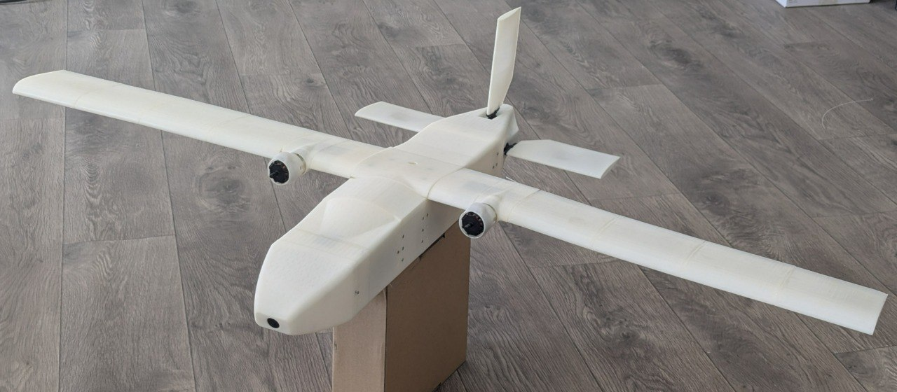
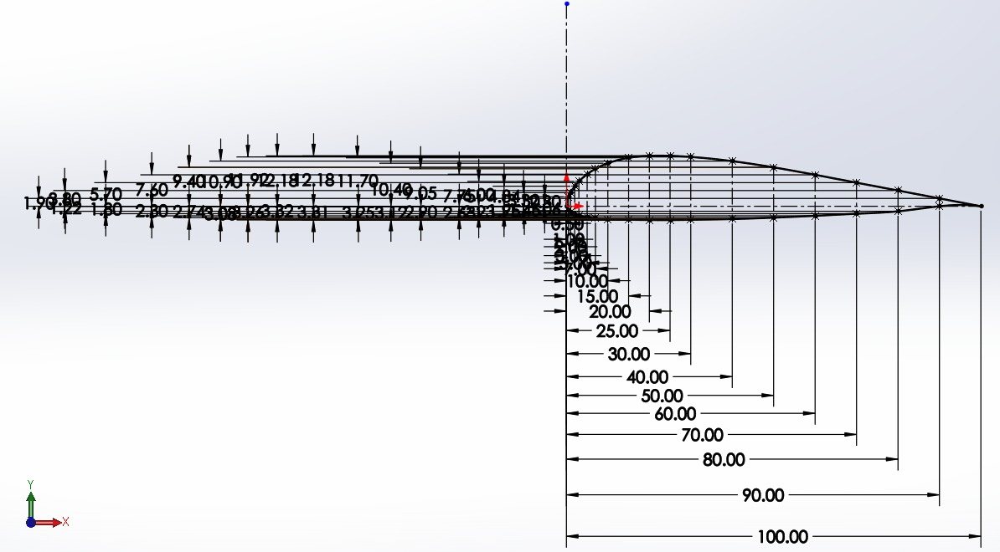
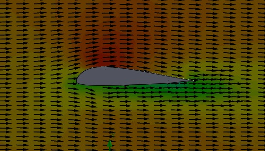
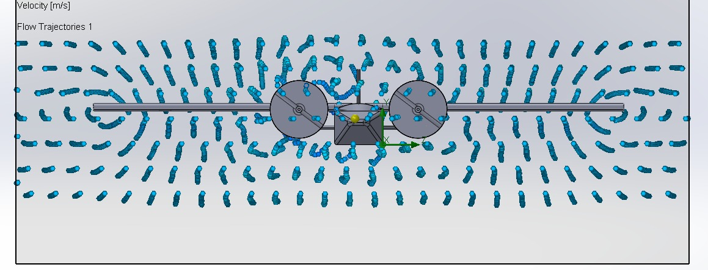
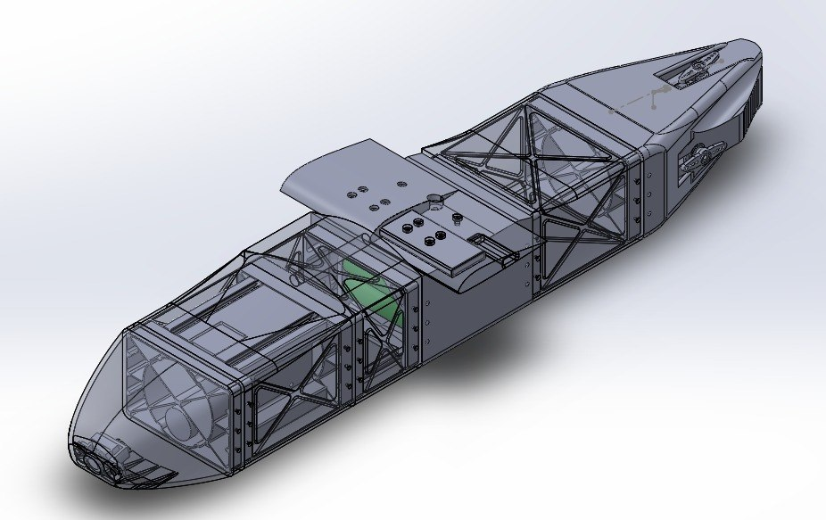
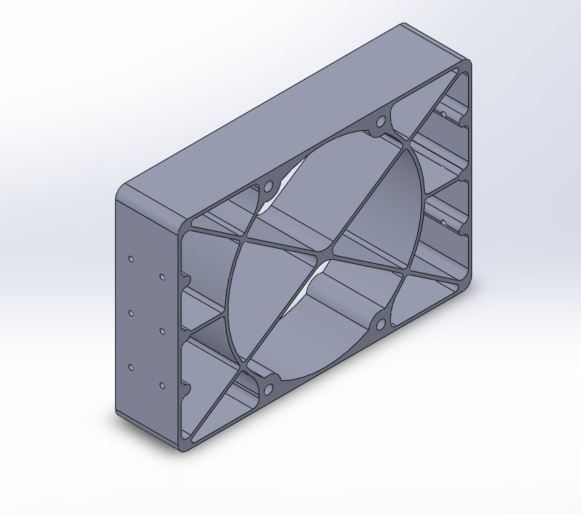
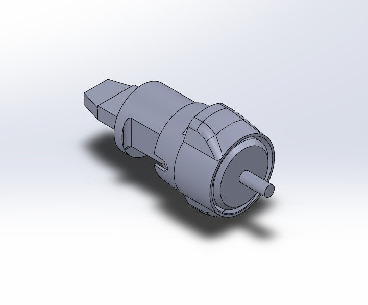
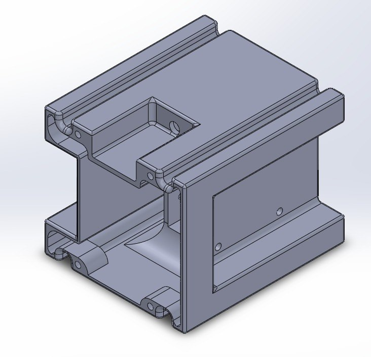
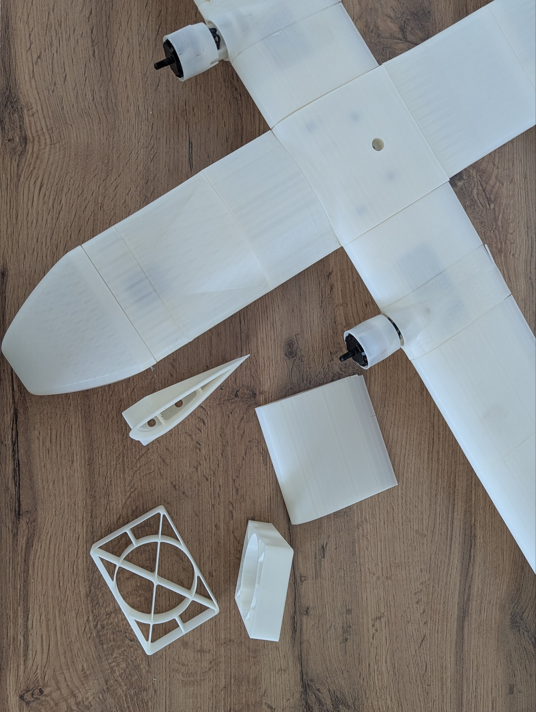
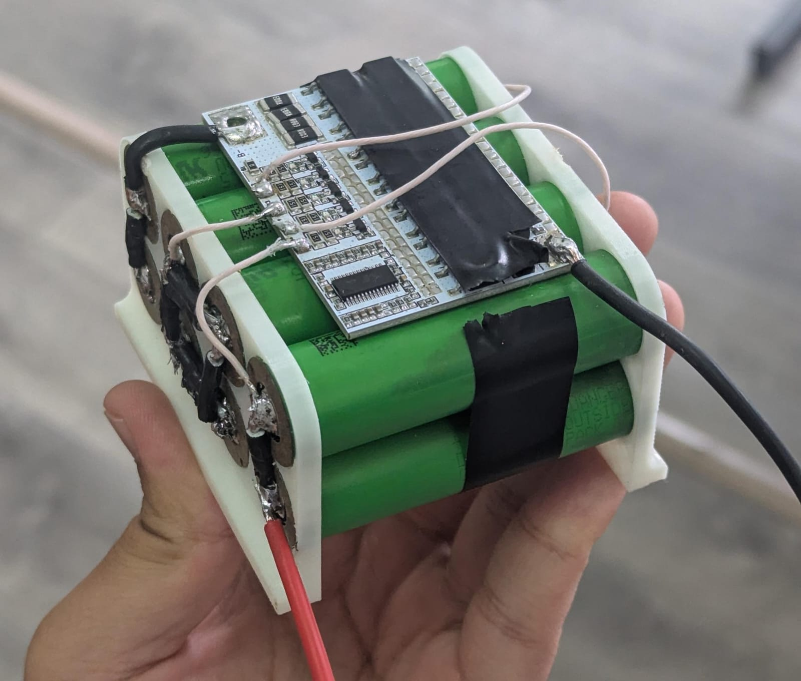

# Twin-Motor Fixed-Wing UAV — CAD

SolidWorks CAD for a **twin-motor, high-wing, FDM-printed fixed-wing UAV** designed from scratch as a flying test platform for avionics. The airframe was designed, printed and assembled at the Rapid Additive Laboratory of the Institute of Mechanical Engineering and Automation, National Academy of Sciences of the Kyrgyz Republic (NAS KR), during a summer 2026 internship.



🎬 **Assembly animation:** [Videos/Main assemnly.mp4](Videos/Main%20assemnly.mp4)

## Overview

The aircraft is meant to carry and test electronics (sensors, video, flight-control hardware) before they are installed on the Academy's main aircraft. That drove the layout:

- **High-wing, twin-motor** configuration, inspired by cargo aircraft such as the Il-76 and C-130, with an enlarged tail for stability.
- **Rectangular fuselage** to make efficient use of internal volume for payload.
- **Fully 3D-printed structure** (FDM), designed around print orientation, layer strength and shrinkage.
- **Removable electronics cartridge** and a **sliding battery tray** for easy maintenance and center-of-mass tuning.

| Parameter | Value |
|---|---|
| Target take-off weight | ~2 kg (1.6 kg design mass used in CFD) |
| Wingspan | 1300 mm (increased from 1100 mm to lower stall speed) |
| Main wing airfoil | P-IIIA, 100 mm chord |
| Tail airfoil | NASA-0012 (symmetric), 54 mm root → 80 mm tip chord |
| Tail area | 2 × 10 180 mm² (20 360 mm² total, ≈16% of wing area) |
| Control | Elevon mode (control surfaces on the tail only) |
| Propulsion | 2 × ReadyToSky RS2205 BLDC, 2 × LittleBee 30A ESC |
| Power | 4S2P Li-ion (8 × US18650VTC5), 16.4 V, 5200 mAh, 4S 100 A BMS |
| Flight controller | Matek F405-Wing V2 (INAV) |
| Printer / slicer | FLSUN V400 / Orca Slicer |

## Design highlights

### Aerodynamics
The main wing uses the **P-IIIA** airfoil for its good lift-to-drag ratio and predictable stall. It is hollow with a spar at the thickest point of the profile to carry bending loads. Tail surfaces use a symmetric NASA-0012 profile. Airfoil ordinates are given in the [Airfoil data](#airfoil-data) section.

A SolidWorks Flow Simulation at 16.67 m/s (60 km/h) and 16° angle of attack gave **17.4 N lift and 0.373 N drag** for a 1.6 kg design mass; the calculated cruise speed at 8° angle of attack is about **52 km/h**.

<p>
  
  
</p>



### Fuselage
The fuselage is built section by section:

- **Central section** with an insert matching the wing's hollow shape, secured with screws and nuts and covered by a removable fairing.
- **Internal frame** with a central ring and diagonal stiffeners (2 mm walls) to spread wing and tail loads.
- **Nose section** with the camera opening angled 15° down and cooling air intakes, modeled with the Lofted Boss/Base tool.
- **60 mm fuselage extension** with sliding rails so the battery can be moved to tune the center of mass, held by a Π-shaped frame with extra stiffeners.
- **Electronics cartridge** holding the flight controller, GPS, receiver and video transmitter, sliding on four rails for quick access.

<p>
  
  
</p>

### Wing attachment
The wing mounts to the fuselage with **no external screws**: a cantilever bracket printed vertically, reinforced by a spar pin printed horizontally (to compensate for weak inter-layer strength), all covered by a fairing shaped like the wing profile. Sharp corners on the mounting parts were rounded off, since they were stress concentrators.

### Motor nacelles
Nacelles are B-29-style mounts that install from below, so a motor or ESC can be swapped easily. They have 10 mm clearance between propeller and fuselage and 1 mm walls. The motor-to-fairing gap was increased from 0.5 mm to 1.5 mm after the first version caused vibration, and one motor mount was enlarged after failing a strength test.

<p>
  
  
</p>

## Manufacturing notes

All structural parts are FDM-printed (FLSUN V400, up to three printers in parallel). The wing is split into **13 sections of 100 mm with 32 alignment pins** to stop tall parts from warping. Sections are joined with two-part epoxy and superglue, then sanded for fit and reduced drag.

Lessons learned during printing, now reflected in the models:

| Problem | Fix |
|---|---|
| Delamination from unstable room temperature | Keep room at 25 °C; reprint only the damaged section |
| Round nacelle printed oval (ABS shrinkage in thin hollow walls) | Redesigned the nacelle |
| Uneven shrinkage on complex parts | Simplified part geometry |
| Rough surface on near-horizontal prints | Reoriented parts |
| Weak layer direction at wing mounts | Vertical bracket + horizontal spar pin |



## Bill of materials (electronics)

Each component was modeled in CAD from caliper measurements to check fit before printing.

| Component | Purpose | Qty | Unit weight (g) | Unit price (USD) |
|---|---|---|---|---|
| ReadyToSky LittleBee 30A ESC | BLDC motor driver | 2 | 8 | 8.82 |
| ReadyToSky RS2205 | BLDC motor | 2 | 35 | 7.89 |
| Matek F405-Wing V2 | Flight controller | 1 | 25 | 42.50 |
| NZ GPS | GPS module | 1 | 9 | 10.50 |
| ReadyToSky 48H 5.8G 600 mW | Video/telemetry TX | 1 | 15 | 5.50 |
| US18650VTC5 18650 cell | Battery (4S2P pack) | 8 | 44.3 | 3.00 |
| FS-iA10B | 10-channel receiver | 1 | 19.3 | 12.54 |
| Futaba 20 kg metal-gear servo | Servomotor | 3 | 55 | 2.80 |
| Caddx Ratel 2 | FPV camera | 1 | 5.9 | 18.74 |
| **Total** | | | **679.6 g** | **$155.60** |

Transmitter: FlySky FS-i6, reflashed from 6 to 10 channels.



> **Note:** the receiver fit-check model in `Dimensions of parts` is the FS-iA6A. It was modeled before the switch to the FS-iA10B, and no separate FS-iA10B model was made.

## Airfoil data

<details>
<summary>Main wing — P-IIIA, chord 100 mm</summary>

| x (mm) | Yu (mm) | Yl (mm) |
|---|---|---|
| 0 | 0.00 | 0.00 |
| 0.5 | 2.30 | 1.06 |
| 1 | 3.30 | 1.45 |
| 2 | 4.84 | 1.95 |
| 3 | 6.00 | 2.23 |
| 5 | 7.75 | 2.63 |
| 7 | 9.05 | 2.90 |
| 10 | 10.40 | 3.12 |
| 15 | 11.70 | 3.25 |
| 20 | 12.18 | 3.31 |
| 25 | 12.18 | 3.32 |
| 30 | 11.92 | 3.26 |
| 40 | 10.90 | 3.08 |
| 50 | 9.40 | 2.74 |
| 60 | 7.60 | 2.30 |
| 70 | 5.70 | 1.80 |
| 80 | 3.80 | 1.22 |
| 90 | 1.90 | 0.00 |
| 100 | 0.00 | 0.00 |

</details>

<details>
<summary>Stabilizers — NASA-0012 (symmetric), root 54 mm / tip 80 mm</summary>

| Root x (mm) | Yu = Yl (mm) | Tip x (mm) | Yu = Yl (mm) |
|---|---|---|---|
| 0.675 | 1.02276 | 1 | 1.5152 |
| 1.35 | 1.41210 | 2 | 2.0920 |
| 2.7 | 1.91970 | 4 | 2.8440 |
| 4.05 | 2.26800 | 6 | 3.3600 |
| 5.4 | 2.52882 | 8 | 3.7464 |
| 8.1 | 2.88630 | 12 | 4.2760 |
| 10.8 | 3.09798 | 16 | 4.5896 |
| 13.5 | 3.20814 | 20 | 4.7528 |
| 16.2 | 3.24108 | 24 | 4.8016 |
| 21.6 | 3.13362 | 32 | 4.6424 |
| 27 | 2.85876 | 40 | 4.2352 |
| 32.4 | 2.46402 | 48 | 3.6504 |
| 37.8 | 1.97856 | 56 | 2.9312 |
| 43.2 | 1.41642 | 64 | 2.0984 |
| 48.6 | 0.78192 | 72 | 1.1584 |
| 51.3 | 0.43578 | 76 | 0.6456 |
| 54 | 0.06804 | 80 | 0.1008 |

</details>

## Repository structure

```
.
├── 3D design/
│   └── Solidworks file/
│       ├── Main/
│       │   ├── Assemblies/          # Top-level assemblies (Main assemnly.SLDASM, wing, battery pack, servo)
│       │   ├── Battery holders/     # 18650 4S2P holder parts + STL
│       │   ├── Engine Nacelle/      # Motor nacelles, ESC holder + STL
│       │   ├── Fuselage/            # Fuselage sections, frame, cartridge + STL
│       │   ├── Wings/               # Wing sections, spar, tail + STL
│       │   └── Printing.3mf         # Orca Slicer print project
│       ├── Dimensions of parts/     # Caliper-measured models of electronics (motors, ESC, GPS, servo, props…)
│       └── gcode/                   # Sliced G-code (ABS) for FLSUN V400
├── Docs/
│   ├── Datasheets/                  # 18650 cell, ST L78 voltage regulator
│   ├── images/                      # Pictures used in this README
│   ├── BOM NASKR drone.xlsx         # Bill of materials
│   ├── Профиль P-iii.xlsx           # P-IIIA airfoil ordinates
│   ├── Spravochnic_avia_profiley.pdf# Airfoil reference handbook
│   └── SPRacingF3-Manual-latest.pdf
├── Videos/
│   └── Main assemnly.mp4            # Assembly animation
├── LICENSE
└── README.md
```

## Getting started

1. Open [`3D design/Solidworks file/Main/Assemblies/Main assemnly.SLDASM`](3D%20design/Solidworks%20file/Main/Assemblies) in **SolidWorks 2024** (older versions cannot open these files). Keep the folder structure intact so the assembly finds its parts.
2. Ready-to-print meshes are in the `STL/` subfolders of each section; ready G-code for the FLSUN V400 (ABS) is in [`gcode/`](3D%20design/Solidworks%20file/gcode). The full print project is `Main/Printing.3mf` (Orca Slicer).
3. Follow the print-orientation notes above, especially for wing mounts, nacelles and the wing sections.
4. After installing the electronics, check the center of mass and use the battery tray rails to tune it.

## Status

The airframe is fully assembled, with all electronics installed, and passed ground tests: motors, ESCs and 6 mm² power wiring were bench-tested (without propellers) and functional tests succeeded. **No flight testing has been done yet**, and the aerodynamic numbers above come from SolidWorks Flow Simulation and hand calculations, not flight data.

## Credits

- **Design and build:** Kutman Malikov — Bahçeşehir Cyprus University (BAU Cyprus), Electrical and Electronics Engineering
- **Supervisor:** Artem Prozorov, NAS KR
- **Host:** Rapid Additive Laboratory, Institute of Mechanical Engineering and Automation, NAS KR

Based on the EEE 4995 summer training report, *Design and Development of a Twin-Motor Fixed-Wing UAV* (2026).

## License

Released under the [Apache License 2.0](LICENSE).
